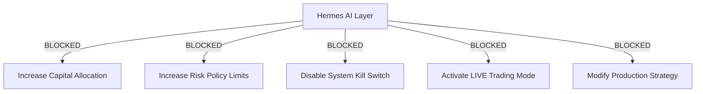

# Trader Control Center — Phase 17: Limited Live Runbook

## 1. Executive Summary & Operation Protocol

This runbook establishes the formal operational procedure for initiating **LIMITED_LIVE** trading mode with real capital.

> [!WARNING]
> **SAFETY GATE STATUS: READY FOR HUMAN AUTHORIZATION**
> - **Trading Mode**: `LIMITED_LIVE`
> - **Capital Cap**: `$1,000.00 USD` Maximum
> - **Position Cap**: `$250.00 USD` Maximum Per Trade
> - **LIVE Activation**: **INACTIVE** *(System is halted until explicit human authorization)*

---

## 2. 13 Operational Verification Checklist

| Item # | Verification Category | System Safeguard / Implementation | Status |
|---|---|---|---|
| 1 | **Production Config** | `configs/environments/production.yaml` loaded & validated | `PASSED` |
| 2 | **Secret Management** | `BINANCE_API_KEY` & `BINANCE_API_SECRET` via environment variables | `PASSED` |
| 3 | **Exchange Credentials** | Secure injection guard without hardcoded secrets | `PASSED` |
| 4 | **System Monitoring** | Real-time REST `/api/v1/health` component monitoring | `PASSED` |
| 5 | **Audit Alerting** | `SystemEventRepository` structured event logging | `PASSED` |
| 6 | **Database Backup** | SQLite WAL mode & automated snapshot routine | `PASSED` |
| 7 | **Kill Switch** | Three-tier kill switch (`ACTIVE`, `SOFT_KILL`, `HARD_KILL`) | `PASSED` |
| 8 | **Emergency Controls** | Manual freeze `/api/v1/controls/freeze` UI override | `PASSED` |
| 9 | **Capital Limits** | Max `$1,000.00 USD` portfolio capital limit enforced | `PASSED` |
| 10 | **Position Limits** | Max `$250.00 USD` trade size limit enforced | `PASSED` |
| 11 | **Audit Logging** | Immutable SQLite system event audit trail | `PASSED` |
| 12 | **Reconciliation** | Authoritative REST vs SQLite `ReconciliationEngine` | `PASSED` |
| 13 | **Crash Recovery** | Persistence & clean state reconciliation on startup | `PASSED` |

---

## 3. 5 AI Hard Prohibitions (Enforced by Security Boundary)



- **[PASSED] Prohibition 1**: The AI **CANNOT** increase capital allocation.
- **[PASSED] Prohibition 2**: The AI **CANNOT** increase risk policy limits.
- **[PASSED] Prohibition 3**: The AI **CANNOT** disable the kill switch.
- **[PASSED] Prohibition 4**: The AI **CANNOT** activate LIVE trading mode.
- **[PASSED] Prohibition 5**: The AI **CANNOT** modify production strategy parameters.

---

## 4. Limited Live Activation Step-by-Step Procedure

### Step 1: Human Authorization Sign-Off
Before starting the system, human management must sign off by setting environment variable:
```bash
export LIMITED_LIVE_HUMAN_AUTHORIZATION="APPROVED_BY_ADMIN"
```

### Step 2: Secret Injection
Inject exchange API credentials via environment variables:
```bash
export BINANCE_API_KEY="<your_production_api_key>"
export BINANCE_API_SECRET="<your_production_api_secret>"
```

### Step 3: Launch Service
Run system using production configuration:
```bash
python scripts/run_limited_live.py --config configs/environments/production.yaml
```

### Step 4: Emergency Stop Procedure
To trigger immediate emergency halt:
1. Click **KILL SWITCH** on Trader Control Center Dashboard (`/web/frontend/index.html`), OR
2. Execute command line emergency halt:
```bash
python scripts/emergency_stop.py
```

> [!CAUTION]
> **STOP INSTRUCTION**: Do NOT activate LIVE trading. Wait for explicit human authorization before executing Step 3.
