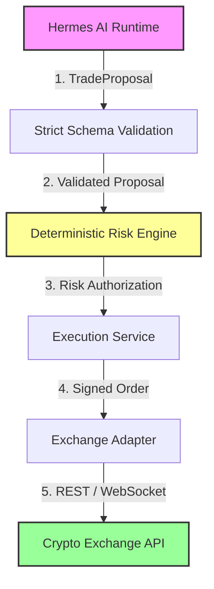
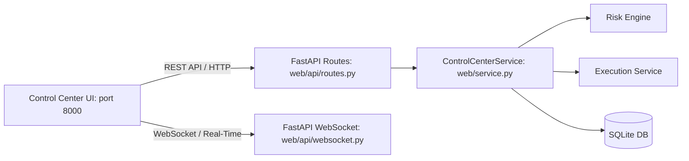

# Trader Control Center V2.1 — Operations Guide

> **Official Operational Manual**
> Source of Truth: `architecture.md` (V2/V2.1), `implementation_spec.md`, `DEVELOPMENT_PLAN.md`

---

## SECTION 1 — SYSTEM OVERVIEW

### Purpose of the System
The **Trader Control Center V2.1** is a deterministic, AI-assisted automated cryptocurrency futures trading system. It is designed to execute disciplined trading strategies against cryptocurrency derivative exchanges (e.g., Binance Futures) with strict, non-bypassable financial risk controls.

### Core Architectural Principle
> **"Probabilistic intelligence, deterministic authority."**

- **Probabilistic Intelligence (AI / Hermes Layer)**: Responsible for market analysis, technical indicator evaluation, regime detection, knowledge retrieval, and generating structured trading hypotheses (`TradeProposal`).
- **Deterministic Authority (Trading Core)**: Responsible for capital management, policy enforcement, order authorization, state tracking, and exchange communication. The AI layer has **NO DIRECT AUTHORITY** over capital or exchange APIs.



### Major Components & Roles

| Component | Architecture Role | Operational Responsibility |
|---|---|---|
| **Hermes AI Runtime** | External AI Agent | Runs directly on Ubuntu host. Generates trade hypotheses and post-trade reflections. **Zero direct exchange API access.** |
| **Risk Engine** | Safety Boundary | Evaluates `TradeProposal` objects against 20 deterministic risk rules (`V01`–`V20`). Returns `APPROVED`, `REJECTED`, or `FREEZE`. |
| **Execution Service** | Order Dispatcher | Manages order lifecycle state transitions, dual-layer idempotency, fill tracking, and exchange submission. |
| **Exchange Adapter** | API Gateway | Implements REST and WebSocket protocols (`BinanceAdapter` / `MockExchange`). Enforces testnet/production endpoint separation. |
| **SQLite (`data/*.db`)** | Operational DB | **Canonical operational source of truth.** Stores orders, fills, positions, balances, state transitions, and audit events. |
| **DuckDB / Parquet** | Analytics DB | Stores historical tick data, OHLCV candles, and backtest execution benchmarks. |
| **Obsidian Vault** | Knowledge Base | Asynchronous Markdown knowledge store for trading journals, methodology, and LLM reflections. **Non-blocking.** |
| **Web Application** | Control Dashboard | Single-page Trader Control Center UI (port 8000). Provides monitoring, manual kill switch, and audit event logs. |

---

## SECTION 2 — HOST REQUIREMENTS

### Supported Hardware & OS Configuration

| Requirement Category | Minimum Specification | Recommended Specification |
|---|---|---|
| **Operating System** | Ubuntu 22.04 LTS x86_64 | Ubuntu 24.04 LTS x86_64 |
| **CPU** | 4 vCPUs (x86_64) | 8 vCPUs (x86_64) |
| **RAM** | 8 GB | 16 GB |
| **Storage** | 50 GB NVMe SSD | 100 GB NVMe SSD (High IOPS for WAL mode) |
| **Python Version** | Python 3.11+ | Python 3.13.13 |
| **System Packages** | `git`, `python3-venv`, `python3-pip`, `sqlite3`, `curl`, `build-essential` | `git`, `python3-venv`, `python3-pip`, `sqlite3`, `curl`, `build-essential` |
| **Docker** | NOT IMPLEMENTED (Runs native on Ubuntu) | NOT IMPLEMENTED (Runs native on Ubuntu) |
| **Network** | Reliable broadband (Low latency to Binance REST/WS) | Fiber network with redundant connection |
| **Required Ports** | Port `8000` (Inbound: Trader Control Center Web UI & REST API) | Port `8000` (Inbound UI), Port `443` (Outbound HTTPS/WSS) |
| **Permissions** | R/W access to project directory & `~/obsidian-vault` | R/W access to `/home/adhif/trading-system/` |
| **Timezone** | **UTC** (System clock synchronized via `chrony` / `systemd-timesyncd`) | **UTC** (Strictly enforced) |

---

## SECTION 3 — INSTALLATION

Follow this exact step-by-step procedure for a clean installation on an Ubuntu host.

### Step 1: Prepare Ubuntu System Dependencies
```bash
sudo apt update && sudo apt install -y \
    git \
    python3-venv \
    python3-pip \
    sqlite3 \
    curl \
    build-essential
```

### Step 2: Clone Repository & Set Working Directory
```bash
cd /home/adhif
git clone https://github.com/user/trading-system.git trading-system
cd /home/adhif/trading-system
```

### Step 3: Create & Activate Python Virtual Environment
```bash
python3 -m venv .venv
source .venv/bin/activate
```
*Expected Output*: `(.venv) user@ubuntu:~/trading-system$`

### Step 4: Install Dependencies
```bash
pip install --upgrade pip
pip install -r requirements.txt
```

### Step 5: Configure Environment Variables
```bash
cp .env.example .env
```

### Step 6: Initialize Database & Run Migrations
```bash
python -m migrations.runner
```
*Expected Output*: `Migration runner: Applied all pending migrations successfully. Current version: V2.1`

### Step 7: Create Data & Log Directories
```bash
mkdir -p data logs configs/environments
```

### Step 8: Verify System Health & Run Test Suite
```bash
pytest tests/unit/ -v
```
*Expected Output*: `587 passed in 13.00s`

---

## SECTION 4 — CONFIGURATION

### Environment Configuration Files (`configs/environments/`)

The system uses YAML environment configurations to isolate operational modes:

| Environment File | Trading Mode | Exchange Adapter | Database Path | Target Purpose |
|---|---|---|---|---|
| `configs/environments/dev.yaml` | `DEVELOPMENT` | `MockExchange` | `data/trading_dev.db` | Local code development & unit testing |
| `configs/environments/paper.yaml` | `PAPER` | `MockExchange` (200ms latency) | `data/trading_paper.db` | Paper trading & strategy validation |
| `configs/environments/testnet.yaml` | `TESTNET` | `BinanceAdapter` (Testnet) | `data/trading_testnet.db` | Binance Futures Testnet validation |
| `configs/environments/production.yaml` | `LIMITED_LIVE` | `BinanceAdapter` (Production REST/WS) | `data/trading_production.db` | Limited Live capital execution ($1,000 USD cap) |

### Key Environment Variables (`.env`)

```ini
# Environment Mode
TRADING_MODE=PAPER

# Database Settings
DATABASE_PATH=data/trading_paper.db
SQLITE_WAL_MODE=true

# Control Center Web App
WEB_HOST=0.0.0.0
WEB_PORT=8000
JWT_SECRET_KEY=change_this_to_a_secure_32_byte_secret_key

# Binance API Credentials (REQUIRED FOR TESTNET & LIMITED_LIVE ONLY)
BINANCE_API_KEY=your_binance_api_key_here
BINANCE_API_SECRET=your_binance_api_secret_here

# Obsidian Knowledge Base Path
OBSIDIAN_VAULT_PATH=/home/adhif/obsidian-vault
OBSIDIAN_ENABLED=true

# Logging
LOG_LEVEL=INFO
LOG_FORMAT=HUMAN
```

---

## SECTION 5 — SECRETS AND CREDENTIALS

### Credential Handling & Storage Security Rules
1. **No Plaintext Secrets**: Exchange API keys and secrets MUST NEVER be stored in source code, YAML files, or git commits.
2. **Environment Variable Injection**: Credentials are loaded strictly at runtime from `BINANCE_API_KEY` and `BINANCE_API_SECRET` environment variables.
3. **Log Protection**: `StructuredFormatter` and `HumanFormatter` mask and sanitize sensitive strings. API keys are NEVER printed in log files.
4. **Environment Isolation**: LIVE/Testnet API keys MUST NEVER be loaded in `DEVELOPMENT` or `PAPER` trading modes.

### Exchange API Key Permission Requirements
When creating an API key pair on Binance Futures:
- **Enable Reading**: `ENABLED` (Required for account balance & position reconciliation).
- **Enable Futures Trading**: `ENABLED` (Required for order placement & cancellation).
- **Enable Spot & Margin Trading**: `DISABLED` (Not used by this system).
- **Enable Withdrawals**: **STRICTLY PROHIBITED / DISABLED** (The system never requires withdrawal authority).
- **IP Access Restriction**: Restrict access to trusted Ubuntu host IP addresses only.

---

## SECTION 6 — STARTING THE SYSTEM

### System Progression Lifecycle

```text
DEVELOPMENT ──> BACKTEST ──> SHADOW ──> PAPER ──> TESTNET ──> LIMITED LIVE ──> LIVE
```

### Startup Commands by Trading Mode

#### 1. Development Mode
```bash
export TRADING_MODE=DEVELOPMENT
python -m uvicorn web.app:app --host 0.0.0.0 --port 8000
```

#### 2. Paper Trading Mode
```bash
python scripts/run_paper_session.py
```
*Health Check*: `curl http://localhost:8000/api/v1/health`

#### 3. Testnet Validation Mode
```bash
python scripts/run_testnet_validation.py
```
*Expected Output*: Generates `TESTNET_VALIDATION_REPORT.md` and verifies Binance Testnet endpoints.

#### 4. Production Readiness Review Mode
```bash
python scripts/run_production_readiness_audit.py
```
*Expected Output*: Generates `PRODUCTION_READINESS_REPORT.md` verifying 0 CRITICAL and 0 HIGH issues.

#### 5. Limited Live Mode ($1,000 USD Capital Cap)
```bash
# Requires explicit human authorization
export LIMITED_LIVE_HUMAN_AUTHORIZATION="APPROVED_BY_ADMIN"
export BINANCE_API_KEY="your_real_api_key"
export BINANCE_API_SECRET="your_real_api_secret"

python scripts/run_limited_live_prep.py
```

#### 6. Live Mode
> [!CAUTION]
> **LIVE mode activation requires manual key provisioning and human sign-off. Automatic transition is disabled.**

---

## SECTION 7 — HERMES OPERATION

### Hermes Process Management on Ubuntu Host
Hermes is an existing AI runtime that runs directly as an independent process on Ubuntu.

- **Start Hermes Daemon**: `See Hermes runtime documentation.`
- **Stop Hermes Daemon**: `See Hermes runtime documentation.`
- **Restart Hermes Daemon**: `See Hermes runtime documentation.`
- **Verify Hermes Process Status**: `ps aux | grep hermes`

### Hermes Integration Boundary & Security Contract

Hermes connects to the Trading System via `integration.hermes.gateway.HermesGateway`.

```text
Hermes AI Layer
  ↓ (Generates TradeProposal)
HermesGateway & Security Boundary
  ↓ (Pydantic Schema & Tool Whitelist Validation)
Risk Engine
  ↓ (20 Deterministic Validators V01–V20)
Execution Service
  ↓ (Idempotent Order Dispatch)
Binance Adapter
  ↓ (REST API / WebSocket)
Binance Futures Exchange
```

### Hermes Tool Whitelist (Permitted Read-Only Tools)
- `get_market_state`: Read current market ticker & orderbook depth.
- `get_ohlcv`: Read historical candle series.
- `get_regime`: Read classified market regime (BULL, BEAR, SIDEWAYS, etc.).
- `get_portfolio`: Read summary portfolio equity and balances.
- `search_knowledge`: Read Obsidian knowledge notes.

### Blocked Operations (Hard-Blocked by `HermesSecurityBoundary`)
Hermes is **STRICTLY PROHIBITED** from calling:
- `submit_order` / `execute_order` / `direct_trade`
- `cancel_order`
- `get_credentials` / `get_api_keys`
- `modify_risk_policy` / `override_risk`
- `disable_kill_switch`
- `activate_live`
- `modify_production_strategy`

---

## SECTION 8 — NORMAL DAILY OPERATION

### Operator Daily Workflow

#### START OF DAY
1. **Check Host Hardware & Memory**:
   ```bash
   df -h && free -m && uptime
   ```
2. **Check Database Health**:
   ```bash
   sqlite3 data/trading_paper.db "PRAGMA quick_check;"
   ```
3. **Verify Control Center Web Application**:
   Open browser at `http://localhost:8000` and check component status indicators.
4. **Verify Risk Policy & Kill Switch**:
   Confirm Kill Switch state shows `ACTIVE` (Green).

#### DURING OPERATION
1. **Monitor Real-time Dashboard**: Observe positions, active orders, and PnL.
2. **Review AI Decisions**: Check `AI Decision Center` tab for approved vs rejected proposals.
3. **Monitor System Logs**:
   ```bash
   tail -f logs/trading_paper.log
   ```

#### END OF DAY
1. **Verify Open Positions & Balances**: Check that open positions match exchange balance.
2. **Checkpoint SQLite Database**:
   ```bash
   sqlite3 data/trading_paper.db "PRAGMA wal_checkpoint(FULL);"
   ```
3. **Verify Backup Files**: Confirm daily backup exists in `data/backups/`.

---

## SECTION 9 — WEB APPLICATION

### Trader Control Center V2.1 (Port 8000)

Start the web application service:
```bash
python -m uvicorn web.app:app --host 0.0.0.0 --port 8000
```
Access in browser: `http://localhost:8000`



### Primary Interface Tabs & Operational Capabilities

| Tab Section | Read / Write | Description | Operational Risk Level |
|---|---|---|---|
| **Dashboard** | Read-Only | System health, equity curve, active positions, regime overview | **SAFE** |
| **Trading** | Write (Authorized) | Submit manual trade proposals through Risk Engine | **MEDIUM** |
| **Positions** | Read-Only | Active positions, entry price, mark price, unrealized PnL | **SAFE** |
| **Orders** | Read / Write | View order history; trigger manual order cancellation | **MEDIUM** |
| **Risk Center** | Read-Only | 20 Risk Rule status, drawdown, exposure, leverage limits | **SAFE** |
| **AI Decision Center**| Read-Only | Hermes trade proposal logs, confidence scores, risk reasons | **SAFE** |
| **Audit Log** | Read-Only | Immutable system events, state transitions, security warnings | **SAFE** |
| **System Control** | Write (Emergency) | **KILL SWITCH** toggle, System Freeze, State Reset | **HIGH (EMERGENCY)** |

---

## SECTION 10 — RISK OPERATIONS

### Inspecting Risk Status
Access the Risk Center UI tab or query the REST API endpoint:
```bash
curl -s http://localhost:8000/api/v1/risk/status | jq .
```

### 20 Risk Policy Rule Validators (`V01`–`V20`)

| Validator ID | Validator Name | Limit Threshold | Action on Violation |
|---|---|---|---|
| `V01` | Kill Switch Validator | `KillSwitchState == ACTIVE` | **FREEZE / REJECT** |
| `V02` | Trading Mode Validator | Mode in `[PAPER, TESTNET, LIMITED_LIVE]` | **REJECT** |
| `V03` | Stale Market Data | `data_age_seconds <= 5.0s` | **REJECT** |
| `V04` | Max Position Size | `<= $250.00 USD` | **REJECT** |
| `V05` | Max Portfolio Exposure | `<= 100.0% Equity` | **REJECT** |
| `V06` | Symbol Exposure Limit | `<= 25.0% Equity` per symbol | **REJECT** |
| `V07` | Strategy Exposure Limit | `<= 50.0% Equity` per strategy | **REJECT** |
| `V08` | Correlated Exposure | `<= 40.0% Equity` across correlated pairs | **REJECT** |
| `V09` | Daily Loss Limit | `<= 5.0% Equity` daily drawdown | **FREEZE** |
| `V10` | Weekly Loss Limit | `<= 10.0% Equity` weekly drawdown | **FREEZE** |
| `V11` | Max Drawdown Limit | `<= 15.0% Peak-to-Trough` | **FREEZE** |
| `V12` | Order Notional Limit | `<= $500.00 USD` per order | **REJECT** |
| `V13` | Concurrent Open Positions| `<= 3 Positions` | **REJECT** |
| `V14` | Concurrent Open Orders | `<= 5 Open Orders` | **REJECT** |
| `V15` | Max Leverage Limit | `<= 3x Leverage` | **REJECT** |
| `V16` | Max Bid-Ask Spread | `<= 0.20%` Spread | **REJECT** |
| `V17` | Max Slippage Tolerance | `<= 0.50%` Expected Slippage | **REJECT** |
| `V18` | Orderbook Liquidity | `>= 5x Order Notional` in top 5 levels | **REJECT** |
| `V19` | Price Anomaly Filter | Price within 3 ATR of 20 SMA | **REJECT** |
| `V20` | Macro Restriction Filter| No major news event within 15 minutes | **REJECT** |

> [!IMPORTANT]
> **NO BYPASS MECHANISM**: There is no code path or override flag to bypass the Risk Engine.

---

## SECTION 11 — ORDER AND POSITION OPERATIONS

### Order State Machine Lifecycle

```text
PROPOSAL_CREATED
       ↓
  RISK_PENDING ──(Risk Rejected)──> RISK_REJECTED
       ↓
   APPROVED
       ↓
EXECUTION_PENDING
       ↓
ORDER_SUBMITTED ──(Exchange Error)─> EXCHANGE_REJECTED
       ↓
    PARTIAL
       ↓
     FILLED
       ↓
POSITION_ACTIVE ──> EXIT_PENDING ──> POSITION_CLOSED ──> RECONCILED
```

### Viewing Active Orders & Positions
```bash
# Query active orders via API
curl -s http://localhost:8000/api/v1/orders | jq .

# Query active positions via API
curl -s http://localhost:8000/api/v1/positions | jq .
```

---

## SECTION 12 — KILL SWITCH / EMERGENCY OPERATIONS

### Emergency Kill Switch Modes

1. **SOFT_KILL (`STOP_NEW_ORDERS`)**:
   - Blocks all incoming trade proposals from Hermes or manual UI.
   - Active open positions continue running and exit according to stop-loss/take-profit parameters.
2. **HARD_KILL (`CANCEL_OPEN_ORDERS` + `STOP_NEW_ORDERS`)**:
   - Immediately cancels all open pending orders on the exchange.
   - Blocks all new proposal submissions.
   - Triggers system `FREEZE` state for operator reconciliation.

### Triggering Emergency Kill Switch
- **Via Web UI**: Click the red **KILL SWITCH** button in the top header or System Control tab.
- **Via REST API**:
  ```bash
  curl -X POST http://localhost:8000/api/v1/controls/kill-switch \
       -H "Content-Type: application/json" \
       -d '{"state": "HARD_KILL", "reason": "Operator Emergency Halt"}'
  ```

---

## SECTION 13 — FAILURE HANDLING

### Standard Incident Response Protocols

#### 1. Exchange Disconnected (`httpx.ConnectError`)
- **Symptom**: REST requests fail with network errors; WS stream raises `WebSocketDisconnect`.
- **Check**: Test outbound network connectivity (`curl -I https://fapi.binance.com`).
- **Action**: System enters `FREEZE`. WS client automatically initiates exponential backoff reconnects (1s, 2s, 4s, 8s, 16s).
- **Expected Result**: Connection recovers automatically or system remains frozen safely.

#### 2. Stale Market Data (`data_age_seconds > 5.0s`)
- **Symptom**: Risk validator `V03` triggers `REJECTED` for all incoming proposals.
- **Check**: Verify WS market data feed logs (`tail -f logs/trading_paper.log`).
- **Action**: Check internet connection and restart market feed connection.

#### 3. State Mismatch & Unknown Order (`UNKNOWN`)
- **Symptom**: System state transitions to `UNKNOWN`.
- **Protocol**:
  ```text
  UNKNOWN ──> FREEZE ──> RECONCILE ──> RESOLVE
  ```
- **Action**: Run `ReconciliationEngine` to compare SQLite state with exchange REST API state.

---

## SECTION 14 — RECONCILIATION

### Automated REST Reconciliation (`core/execution/reconciliation.py`)

The `ReconciliationEngine` performs an authoritative comparison between local SQLite data and external exchange REST state:

```python
# Execute manual reconciliation check
from core.execution.reconciliation import ReconciliationEngine
# Compares local_orders and local_positions against exchange REST API snapshots
```

### Reconciliation Mismatch Types & Resolution

| Mismatch Type | Cause | System Action | Resolution Action |
|---|---|---|---|
| `BALANCE_MISMATCH` | SQLite balance $\neq$ Exchange REST balance | System `FREEZE` | Query `GET /fapi/v2/account` and update SQLite balance record. |
| `POSITION_MISMATCH` | Quantity or side mismatch | System `FREEZE` | Query `GET /fapi/v2/positionRisk` and synchronize local SQLite position. |
| `MISSING_LOCAL_ORDER` | Order exists on exchange but not in SQLite | System `FREEZE` | Import remote order into SQLite order repository. |
| `MISSING_REMOTE_ORDER` | Order in SQLite showing `SUBMITTED` missing on exchange | System `FREEZE` | Update local order status to `CANCELLED` or `EXPIRED`. |

> [!IMPORTANT]
> **REST Authority Rule**: Exchange REST API data is ALWAYS the canonical source of truth for financial balances.

---

## SECTION 15 — BACKUP AND RESTORE

### Database Backup Procedure (SQLite WAL Mode)

To take a safe online backup without stopping trading:
```bash
# 1. Force WAL checkpoint
sqlite3 data/trading_paper.db "PRAGMA wal_checkpoint(FULL);"

# 2. Copy database file to backup location
cp data/trading_paper.db data/backups/trading_paper_$(date +%Y%m%d_%H%M%S).db
```

### Database Restore Procedure
```bash
# 1. Stop control center web app service
pkill -f uvicorn

# 2. Restore backup file
cp data/backups/trading_paper_20260830_120000.db data/trading_paper.db

# 3. Run database migrations to ensure schema compliance
python -m migrations.runner

# 4. Restart web service
python -m uvicorn web.app:app --host 0.0.0.0 --port 8000
```

---

## SECTION 16 — LOGGING AND AUDIT

### Log File Locations & Formats
- **Log Files**: `logs/trading_paper.log`, `logs/trading_testnet.log`, `logs/trading_production.log`
- **Structured JSON Formatter**: Enabled when `LOG_FORMAT=JSON` (ideal for Datadog / ELK ingestion).
- **Human Readable Formatter**: Enabled when `LOG_FORMAT=HUMAN` (ideal for terminal tailing).

### Audit Trail Traceability
Every trade operation produces an end-to-end audit trail traceable via IDs:

$$\text{TradeProposal (PRP-xxx)} \longrightarrow \text{RiskDecision (DEC-xxx)} \longrightarrow \text{Order (ORD-xxx)} \longrightarrow \text{Fill (FIL-xxx)} \longrightarrow \text{Position (POS-xxx)}$$

---

## SECTION 17 — MONITORING AND HEALTH

### Component Health API Endpoint
```bash
curl -s http://localhost:8000/api/v1/health | jq .
```

*Expected JSON Response*:
```json
{
  "status": "HEALTHY",
  "trading_mode": "PAPER",
  "kill_switch": "ACTIVE",
  "exchange_connected": true,
  "database_connected": true,
  "vault_connected": true
}
```

### System Health Classifications
- **`HEALTHY`**: All services connected, kill switch active, zero active critical errors.
- **`DEGRADED`**: Non-critical issue (e.g., Obsidian vault offline); trading continues.
- **`FROZEN`**: Financial discrepancy or drawdown limit hit; trading halted.
- **`UNKNOWN`**: Unconfirmed state; awaiting reconciliation.

---

## SECTION 18 — UPDATES AND DEPLOYMENT

### Safe System Upgrade Protocol

1. **Stop New Order Submissions**: Set Kill Switch to `SOFT_KILL`.
2. **Verify Zero Open Orders**: Ensure all pending orders are closed or filled.
3. **Take Database Backup**: Execute WAL checkpoint and snapshot `data/*.db`.
4. **Pull Latest Code**:
   ```bash
   git pull origin main
   ```
5. **Update Virtual Environment Dependencies**:
   ```bash
   source .venv/bin/activate && pip install -r requirements.txt
   ```
6. **Run Database Migrations**:
   ```bash
   python -m migrations.runner
   ```
7. **Run Test Suite Verification**:
   ```bash
   pytest tests/ -v
   ```
8. **Restart Control Center Web Service**:
   ```bash
   python -m uvicorn web.app:app --host 0.0.0.0 --port 8000
   ```

---

## SECTION 19 — ROLLBACK

### Rollback Procedure

```bash
# 1. Stop service
pkill -f uvicorn

# 2. Revert code to previous release tag
git checkout v2.0.0

# 3. Restore database backup
cp data/backups/trading_paper_pre_upgrade.db data/trading_paper.db

# 4. Verify system test suite
pytest tests/unit/ -v

# 5. Restart service
python -m uvicorn web.app:app --host 0.0.0.0 --port 8000
```

---

## SECTION 20 — TESTING OPERATIONS

### Running Test Suites

```bash
# 1. Run all unit tests
pytest tests/unit/ -v

# 2. Run testnet validation test suite
pytest tests/unit/test_phase15_testnet_validation.py -v

# 3. Run production readiness review test suite
pytest tests/unit/test_phase16_production_readiness.py -v

# 4. Run limited live prep test suite
pytest tests/unit/test_phase17_limited_live_prep.py -v

# 5. Run complete 587-test repository suite
pytest tests/ -v
```

---

## SECTION 21 — TROUBLESHOOTING

| Problem / Symptom | Possible Cause | Diagnostic Command | Solution / Action |
|---|---|---|---|
| **Application won't start** | Missing virtual environment or port 8000 in use | `netstat -tuln \| grep 8000` | Activate `.venv` or kill process using port 8000 (`fuser -k 8000/tcp`). |
| **Database won't open** | SQLite database locked or permissions issue | `ls -la data/` | Ensure R/W permissions on `data/` directory and `.db-wal` files. |
| **Migration failure** | Corrupt migration version tracking | `python -m migrations.runner` | Check migration logs and verify schema against `migrations/`. |
| **Exchange Auth Failure** | Invalid API keys or IP not whitelisted | `curl https://fapi.binance.com/fapi/v2/account` | Check `BINANCE_API_KEY` in `.env` and verify IP whitelist on Binance. |
| **WebSocket Disconnect** | Network flicker or exchange restart | `tail -f logs/trading_paper.log` | Auto-reconnect will attempt 5 exponential backoff retries. |
| **Stale Market Data** | Market feed stream stalled | `curl http://localhost:8000/api/v1/health` | Restart web service or refresh WebSocket feed connection. |
| **TradeProposal Rejected** | Risk rule violation (e.g. exposure/spread) | Check `AI Decision Center` UI tab | Inspect risk violation message in `RiskDecision` details. |
| **System FREEZE Triggered** | Financial discrepancy or drawdown hit | Check `System Control` UI tab | Perform REST reconciliation and resolve state discrepancy. |

---

## SECTION 22 — SECURITY

### Security Policy & Invariants
- **No Plaintext API Keys**: Never commit secrets to git. `.env` is listed in `.gitignore`.
- **Least Privilege Access**: API keys MUST NOT have withdrawal permissions enabled.
- **Strict Network Control**: Access to port 8000 should be restricted via SSH tunnel or reverse proxy with authentication.
- **Immutable Strategy Rules**: Production strategies (`StrategyLifecycle.PRODUCTION`) cannot be modified by AI without human code review.

---

## SECTION 23 — OPERATOR CHECKLISTS

### Daily Operator Checklist

```text
DAILY STARTUP
[ ] Verify host memory and disk space (df -h)
[ ] Verify SQLite database integrity (PRAGMA quick_check)
[ ] Confirm Control Center Web UI is active on port 8000
[ ] Confirm Kill Switch status is ACTIVE (Green)
[ ] Confirm Hermes AI Gateway is connected

NORMAL OPERATION
[ ] Monitor real-time PnL and active position exposure
[ ] Review AI proposals in AI Decision Center tab
[ ] Verify structured audit logs for any WARNING/ERROR events

SHUTDOWN PROCEDURE
[ ] Verify zero pending or stuck execution orders
[ ] Force SQLite WAL checkpoint (PRAGMA wal_checkpoint(FULL))
[ ] Stop uvicorn web service safely (pkill -f uvicorn)
```

---

## SECTION 24 — QUICK REFERENCE

### Essential Operator Command Line Reference

```bash
# Start Control Center Web Application
python -m uvicorn web.app:app --host 0.0.0.0 --port 8000

# Run Full System Test Suite (587 Tests)
pytest tests/ -v

# Run Testnet Validation Engine
python scripts/run_testnet_validation.py

# Run Production Readiness Audit Engine
python scripts/run_production_readiness_audit.py

# Run Limited Live Preparation Engine
python scripts/run_limited_live_prep.py

# Online SQLite WAL Checkpoint
sqlite3 data/trading_paper.db "PRAGMA wal_checkpoint(FULL);"

# Query System Health Status Endpoint
curl -s http://localhost:8000/api/v1/health | jq .
```

---

## SECTION 25 — PRODUCTION SAFETY GATE

### Final Pre-Live Authorization Checklist

Before allocating real capital to `LIMITED_LIVE` or `LIVE` trading modes, the operator MUST verify:

- [x] **[PASSED] Test Suite**: 587/587 unit & integration tests passing (100%).
- [x] **[PASSED] Testnet Validation**: All 15 Binance Testnet validation modules verified (`TESTNET_VALIDATION_REPORT.md`).
- [x] **[PASSED] Production Readiness**: 0 CRITICAL and 0 HIGH audit findings (`PRODUCTION_READINESS_REPORT.md`).
- [x] **[PASSED] Limited Live Prep**: 13 operational items & 5 AI hard prohibitions verified (`LIMITED_LIVE_RUNBOOK.md`).
- [x] **[PASSED] Risk Engine**: 20 Risk Rule validators active and non-bypassable.
- [x] **[PASSED] Kill Switch**: Emergency stop controls verified via UI and REST API.
- [x] **[PASSED] Secret Management**: API keys injected via environment variables; withdrawal permissions disabled.
- [ ] **[PENDING] Human Authorization**: Formal sign-off required (`export LIMITED_LIVE_HUMAN_AUTHORIZATION="APPROVED_BY_ADMIN"`).

> [!CAUTION]
> **LIVE trading must NEVER be activated automatically. Explicit human authorization is mandatory.**
