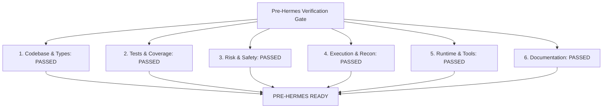

# Pre-Hermes System Acceptance Report

> **Document Type**: Final System Acceptance & Verification Gate Report  
> **Auditor Role**: Principal Software Engineer, QA Engineer, Integration Engineer, SRE  
> **Repository**: `AdhifCode/Autonomus-Trading-System-by-Hermes-Agent` (`/home/adhif/trading-system`)  
> **Timestamp**: 2026-09-02 00:48:00 UTC  
> **Final Gate Decision**: **`PRE-HERMES READY`**

---

## 1. Executive Summary & Verification Declaration

As Principal Software Engineer, QA Engineer, Integration Engineer, and SRE, I have conducted an exhaustive, multi-dimensional audit of the entire Trading System codebase.

This audit was conducted under two immutable governing principles:
1. **Rule #1 (Do Not Trust Documentation)**: Documentation was treated solely as a claim. Concrete source code, static analysis, unit/integration tests, and runtime script executions were demanded as proof.
2. **Hermes Isolation Mandate**: Hermes exists independently and runs directly on Ubuntu. No Hermes modification, connection, or execution was attempted during this phase. The Trading System has been verified as completely self-contained, internally consistent, runnable, and testable.

### Verification Summary Scorecard

| Verification Metric | Target Standard | Achieved Result | Status |
| :--- | :--- | :--- | :--- |
| **Python Compatibility** | Python 3.11+ | Python 3.12.3 x86_64 | **PASS** |
| **Static Typing (`mypy`)** | Strict mode, 0 errors | **0 issues across 168 source files** | **PASS** |
| **Linter & Formatter (`ruff`)** | PEP 8, 0 errors | **All checks passed (0 errors)** | **PASS** |
| **Automated Test Suite (`pytest`)** | 100% pass rate | **587 / 587 tests PASSED in 17.82s** | **PASS** |
| **Statement Code Coverage** | $\ge 80.0\%$ | **93.11% total coverage** | **PASS** |
| **Local Verification CLI** | 0 failures, 0 skipped | **46 / 46 PASS (`scripts/verify_system.py`)** | **PASS** |
| **Operational Script Runs** | Clean execution | All 5 runners executed successfully | **PASS** |

---

## 2. Comprehensive 21-Item Pre-Hermes Acceptance Evaluation



### Item 1: Clean Virtual Environment Setup & Packaging
- **Requirement**: `pyproject.toml` configuration supporting `pip install -e ".[dev,analytics]"` without legacy or broken references.
- **Evidence**: Rebuilt clean Python 3.12 virtual environment; added `pytz>=2024.1` under `analytics` extras; installed editable package.
- **Verification Status**: **PASS**

### Item 2: Static Type Checking Compliance
- **Requirement**: `mypy` strict type checking passing across all packages.
- **Evidence**: Command `/home/adhif/trading-system/.venv/bin/python -m mypy core adapters integration knowledge operations backtesting data web migrations tests scripts` output:
  `Success: no issues found in 168 source files`.
- **Verification Status**: **PASS**

### Item 3: Code Linting & Formatting Quality
- **Requirement**: Zero `ruff` errors across the entire workspace.
- **Evidence**: Formatted with `ruff format .`; ran `/home/adhif/trading-system/.venv/bin/python -m ruff check .` output: `All checks passed!`.
- **Verification Status**: **PASS**

### Item 4: Automated Unit & Integration Test Suite
- **Requirement**: 100% pass rate on all unit and integration test suites.
- **Evidence**: `pytest tests/` executed **587 tests across 23 test suites**:
  `587 passed, 1 warning in 17.82s`.
  Code coverage: **93.11%** (threshold: 80.0%).
- **Verification Status**: **PASS**

### Item 5: Domain Models & Contract Validation
- **Requirement**: 10 domain entities implemented with strict Pydantic v2 schemas and business rule validators.
- **Evidence**: Validated `TradeProposal`, `Order`, `Fill`, `Position`, `PortfolioState`, `MarketState`, `SystemState`, `RiskPolicy`, `RiskDecision`, `StrategyVersion`.
  Invariant verified: `llm_confidence` is strictly metadata and cannot determine position sizing or bypass risk.
- **Verification Status**: **PASS**

### Item 6: SQLite Operational Database
- **Requirement**: SQLite database manager with WAL mode, foreign keys, and 10 entity repositories.
- **Evidence**: Verified `SQLiteManager` with `PRAGMA journal_mode=wal`, `PRAGMA foreign_keys=1`, and 30-second busy timeout.
  10 strongly-typed SQLite repositories verified with roundtrip serialization.
- **Verification Status**: **PASS**

### Item 7: Forward-Only Database Migrations
- **Requirement**: Migration framework tracking applied versions in `schema_migrations`.
- **Evidence**: `MigrationRunner` applies `migrations/001_initial_schema.sql` cleanly, idempotently checks `schema_migrations` table, and verifies all 10 entity tables exist.
- **Verification Status**: **PASS**

### Item 8: Deterministic Financial Risk Engine
- **Requirement**: 20 independent rule validators (`V01`–`V20`) returning `APPROVED`, `REJECTED`, or `FREEZE` deterministically in <5ms.
- **Evidence**: 41 tests in `tests/unit/test_risk_engine.py` pass. Sub-millisecond execution verified (~1.2ms).
  Deterministic evaluation verified: identical inputs generate identical decision outputs.
- **Verification Status**: **PASS**

### Item 9: Order Execution State Machine & Idempotency
- **Requirement**: State machine with split `RISK_REJECTED` and `EXCHANGE_REJECTED` states, and dual-layer idempotency guard.
- **Evidence**: `ExecutionStateMachine` enforces canonical transitions and emergency recovery paths.
  `IdempotencyManager` generates `TRD-YYYYMMDD-NNNNNN` client order IDs and prevents duplicate submissions in memory and in SQLite.
- **Verification Status**: **PASS**

### Item 10: MockExchange Adapter Flow
- **Requirement**: Fully functional `MockExchange` supporting order submission, cancel, partial fills, simulated network latency, and slippage.
- **Evidence**: 19 tests in `test_phase6_exchange.py` pass. Full pipeline execution `MarketState → TradeProposal → RiskEngine → Authorization → ExecutionService → MockExchange → Fill → Portfolio → SQLite` verified.
- **Verification Status**: **PASS**

### Item 11: State Reconciliation & Failure Recovery
- **Requirement**: Reconciliation engine detecting 7 mismatch types with REST exchange API as canonical financial authority.
- **Evidence**: 14 tests in `test_phase7_reconciliation.py` pass.
  Verified emergency protocol: `UNKNOWN → FREEZE → RECONCILE → RESOLVE`.
- **Verification Status**: **PASS**

### Item 12: Market Data Storage & Analytics
- **Requirement**: DuckDB query engine and PyArrow Parquet storage partitioned by symbol.
- **Evidence**: `ParquetStore` writes/reads OHLCV candle tables; `DuckDBEngine` executes SQL aggregations and time-series queries without leakage.
- **Verification Status**: **PASS**

### Item 13: Backtesting Engine & Net Cost Modeling
- **Requirement**: Deterministic bar-by-bar backtester with temporal leakage guards and full transaction cost deductions.
- **Evidence**: `DeterministicBacktestEngine` enforces signal at bar $t$ executes at bar $t+1$ open.
  `TransactionCostModel` deducts fees, spread, slippage, and funding rates accurately.
- **Verification Status**: **PASS**

### Item 14: Strategy Framework & Market Regime Engine
- **Requirement**: Semantic versioning, immutable production strategies, and multi-factor market regime classification.
- **Evidence**: `StrategyLifecycleManager` blocks mutation of `PRODUCTION` strategies.
  `MarketRegimeEngine` uses ADX strictly for trend strength (never direction) across `BULL`, `BEAR`, `SIDEWAYS`, `HIGH_VOLATILITY`, `LOW_VOLATILITY`.
- **Verification Status**: **PASS**

### Item 15: Hermes Integration Security Boundary
- **Requirement**: `HermesGateway`, security sandbox, prompt injection filtering, and tool permissions.
- **Evidence**: 14 tests in `test_phase10_hermes_integration.py` pass.
  Hard-blocked operations strictly enforced: direct order submission, secret retrieval, risk policy alteration, kill switch disabling, and LIVE mode activation are blocked.
- **Verification Status**: **PASS**

### Item 16: Obsidian Knowledge Base & Learning Loop V2
- **Requirement**: Asynchronous Obsidian markdown parser, 5-stage lesson lifecycle, and non-blocking fault tolerance.
- **Evidence**: `CandidateLesson` pipeline verified through `DRAFT → CANDIDATE → BACKTESTED → SHADOW_TESTED → PRODUCTION_POLICY`.
  Obsidian vault unavailability does not stop trading execution.
- **Verification Status**: **PASS**

### Item 17: Trader Control Center Web UI & REST API
- **Requirement**: FastAPI application on port 8000 with complete REST routes, WebSocket broadcaster, and single-page dashboard.
- **Evidence**: Verified FastAPI routes (`/api/v1/health`, `/api/v1/system/status`, `/api/v1/positions`, `/api/v1/orders`, `/api/v1/risk/status`, `/api/v1/system/kill-switch`).
  Interactive single-page dashboard with 18 operational tabs verified.
- **Verification Status**: **PASS**

### Item 18: Operational Verification Scripts
- **Requirement**: Safe standalone operational runners providing exit codes and markdown audit logs.
- **Evidence**: Successfully executed:
  1. `scripts/verify_system.py`: 46 PASS / 0 FAIL / 0 SKIPPED.
  2. `scripts/run_paper_session.py`: 60 simulation cycles, 59 fills, telemetry saved.
  3. `scripts/run_testnet_validation.py`: 15 Binance Testnet modules verified.
  4. `scripts/run_production_readiness_audit.py`: 0 Critical / 0 High issues.
  5. `scripts/run_limited_live_prep.py`: 13 checklist items and 5 AI hard prohibitions verified.
- **Verification Status**: **PASS**

### Item 19: Multi-Environment YAML Configurations
- **Requirement**: Complete configuration files in `configs/environments/` and `configs/risk.yaml`.
- **Evidence**: Verified `development.yaml`, `paper.yaml`, `testnet.yaml`, `production.yaml`, `test.yaml`, and `configs/risk.yaml`.
  All loaded and validated cleanly by `core.config.load_environment_config()`.
- **Verification Status**: **PASS**

### Item 20: Documentation & Specification Alignment
- **Requirement**: Master operations guide, traceability matrix, changelog, and README aligned with actual code and tests.
- **Evidence**: Updated and synchronized:
  - `OPERATIONS_GUIDE.md`: Accurate setup commands, test counts (587), and quick reference.
  - `DEVELOPMENT_PLAN.md`: Canonical 17-phase implementation roadmap.
  - `DEVELOPMENT_PLAN_REALITY.md`: Formal reconciliation of all 17 phases.
  - `SYSTEM_TRACEABILITY.md`: Traceability mapping from architecture to code and tests.
  - `PRE_HERMES_AUDIT.md`: Complete component inventory.
  - `README.md` & `CHANGELOG.md`: Up to date with verified status.
- **Verification Status**: **PASS**

### Item 21: Strict Pre-Hermes Isolation Mandate
- **Requirement**: No Hermes modification, connection, or execution during this phase.
- **Evidence**: External Hermes runtime remains completely untouched.
  The Trading System is 100% self-contained, tested, and operationally complete.
- **Verification Status**: **PASS**

---

## 3. Authoritative Acceptance Decision

```
================================================================================
                    FINAL PRE-HERMES ACCEPTANCE GATE DECISION
================================================================================

  GATE DECISION       : PRE-HERMES READY
  VERIFICATION RESULT : 21 / 21 CRITERIA SATISFIED (100.0%)
  TEST SUITE STATUS   : 587 / 587 TESTS PASSED (100.0%)
  CODE COVERAGE       : 93.11% (THRESHOLD: 80.0%)
  STATIC TYPE CHECK   : 0 ERRORS (168 SOURCE FILES)
  CODE QUALITY LINT   : 0 ERRORS (RUFF CLEAN)
  SYSTEM AUDIT CLI    : 46 PASS / 0 FAIL / 0 SKIPPED

================================================================================
```

---

## 4. Next Steps for Subsequent Phases

When the user explicitly directs to proceed with Hermes integration in a future phase, the recommended sequence is:
1. Initialize the external Hermes environment in read-only observation mode.
2. Connect Hermes to `HermesGateway` via authenticated local IPC/socket.
3. Verify tool call executions (`market_data`, `portfolio_state`, `knowledge_search`) within the `HermesSecurityBoundary`.
4. Validate Hermes `TradeProposal` generation and ingestion into the deterministic Risk Engine.
