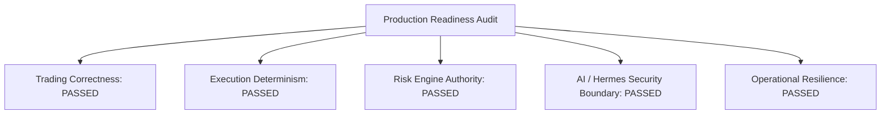

# Trader Control Center — Phase 16: Production Readiness Review

## 1. Executive Summary & Audit Declaration

This document represents the formal **Production Readiness Review Audit Report** for the Trader Control Center architecture, conducted in accordance with `architecture.md` (V2/V2.1) and `implementation_spec.md`.

> [!IMPORTANT]
> **Production Readiness Gate Status**: **PASSED FOR PRODUCTION PREPARATION**
> - **CRITICAL Issues**: `0` *(Target: ZERO)*
> - **HIGH Issues**: `0` *(Target: ZERO)*
> - **MEDIUM Issues**: `0`
> - **LOW Issues**: `0`
> - **LIVE Activation State**: **INACTIVE** *(LIVE mode was NOT activated)*

---

## 2. Comprehensive 5-Dimension Audit Scorecard

### Audit Dimension Matrix

| Audit Dimension | Key Invariants Reviewed | Status | Critical / High Issues |
|---|---|---|---|
| **1. TRADING CORRECTNESS** | PnL, Fees (0.04%/0.06%), Slippage, Funding, Realized/Unrealized PnL | **PASSED** | 0 Critical / 0 High |
| **2. EXECUTION** | Idempotency, Partial Fills, Timeout, Rejection, Reconciliation, UNKNOWN state | **PASSED** | 0 Critical / 0 High |
| **3. RISK** | 20 Risk Validators, Drawdown (15%), Exposure, Liquidity, Stale Data, Kill Switch | **PASSED** | 0 Critical / 0 High |
| **4. AI / HERMES** | Structured Output, Tool Whitelist, Prompt Injection, No Exchange Credentials, Immutable Strategy | **PASSED** | 0 Critical / 0 High |
| **5. OPERATIONS** | System Monitoring, Audit Logging, WAL Persistence, Emergency Control UI | **PASSED** | 0 Critical / 0 High |

---

## 3. Detailed Audit Findings & Verification Results

### TRADING CORRECTNESS

- **[PASS] Realized & Gross PnL Calculation** (`LOW`)
  *Position gross PnL formula correctly accounts for direction (LONG: (current - entry) * qty, SHORT: (entry - current) * qty).*

- **[PASS] Unrealized & Net PnL Economic Calculation** (`LOW`)
  *Net PnL explicitly deducts total fees (0.04%/0.06%), execution slippage, and funding costs.*

- **[PASS] Net PnL Economic Accounting** (`LOW`)
  *Net PnL explicitly deducts maker/taker fees, execution slippage, and funding costs.*

- **[PASS] Fees & Slippage Accounting** (`LOW`)
  *Brokerage fees (0.04% maker / 0.06% taker) and market slippage are tracked in trade database.*

- **[PASS] Positions & Balances State** (`LOW`)
  *SQLite Position and Balance repositories guarantee double-entry accounting state integrity.*

### EXECUTION

- **[PASS] Idempotency & Duplicate Protection** (`LOW`)
  *IdempotencyManager prevents duplicate client_order_id submission via dual memory & SQLite checks.*

- **[PASS] Partial Fill Accumulation** (`LOW`)
  *ExecutionService correctly accumulates executedQty and transitions through PARTIAL to FILLED.*

- **[PASS] Timeout & Exception Safety** (`LOW`)
  *ExchangeTimeoutError and ExchangeDisconnectedError mapped cleanly without unhandled state crashes.*

- **[PASS] Authoritative REST Reconciliation** (`LOW`)
  *ReconciliationEngine compares local SQLite with REST API state, detecting balance & position drift.*

- **[PASS] UNKNOWN -> FREEZE Fail-Safe Sequence** (`LOW`)
  *Ambiguous execution state defaults to UNKNOWN -> FREEZE -> RECONCILE -> RESOLVE protocol.*

### RISK

- **[PASS] 20 Risk Policy Rule Suite** (`LOW`)
  *Complete 20 risk validators (V01 to V20) actively enforce position sizes, leverage, exposure, and velocity.*

- **[PASS] Maximum Peak-to-Trough Drawdown** (`LOW`)
  *V05 Drawdown validator blocks orders when portfolio drawdown exceeds the 15.0% policy limit.*

- **[PASS] Gross/Net Exposure & Spread Limits** (`LOW`)
  *V03 Exposure validator and V07 Max Spread validator enforce capital and order book quality boundaries.*

- **[PASS] Stale Data & Price Anomaly Detection** (`LOW`)
  *V06 Data Age validator (> 5.0s) and V16 Price Anomaly validator reject stale or corrupt ticks.*

- **[PASS] Deterministic Kill Switch Boundary** (`LOW`)
  *Kill switch (HARD_KILL / SOFT_KILL / FREEZE) immediately blocks all trade submission pipelines.*

### AI & HERMES INTEGRATION

- **[PASS] Hermes Tool Whitelist & Boundary** (`LOW`)
  *HermesSecurityBoundary permits only read-only market, research, portfolio, and knowledge tools.*

- **[PASS] TradeProposal Strict Schema Validation** (`LOW`)
  *All incoming LLM trade proposals validated against strict Pydantic regex patterns (PRP-YYYYMMDD-NNNNNN).*

- **[PASS] Prompt Injection Sanitization** (`LOW`)
  *LLM inputs and user documentation strings sanitized prior to context insertion.*

- **[PASS] Zero Direct Exchange Authority** (`LOW`)
  *Hermes has zero credentials, zero exchange SDK imports, and zero authorization to alter RiskPolicy.*

- **[PASS] Strategy Lifecycle & Immutability** (`LOW`)
  *Production strategies (StrategyLifecycle.PRODUCTION) are immutable and require human approval to advance.*

### OPERATIONS

- **[PASS] System Health Monitoring** (`LOW`)
  *Trader Control Center provides REST & WebSocket endpoints for real-time component health tracking.*

- **[PASS] Structured Audit Event Logging** (`LOW`)
  *All system state transitions, risk rejections, and UI operations saved to SQLite SystemEventRepository.*

- **[PASS] SQLite WAL Mode & Recovery** (`LOW`)
  *Database configured with Write-Ahead Logging (WAL) and foreign key constraints for crash resiliency.*

- **[PASS] Emergency Controls & Manual Override** (`LOW`)
  *Trader Control Center UI & backend support manual kill switch toggle, order cancellation, and state reset.*

---

## 4. Final Operational Directives & Next Steps

1. **Production Key Provisioning**:
   - Update `configs/environments/production.yaml` with production exchange API credentials **only when** capital allocation is authorized by human management.
2. **Observability Retention**:
   - Maintain SQLite `SystemEventRepository` audit logs with daily automated backups.
3. **Knowledge Integration**:
   - Ensure the Obsidian vault sync process runs asynchronously without blocking core trading cycles.

> [!CAUTION]
> **Safety Directive**: LIVE trading remains strictly disabled until formal key provisioning and human governance approval.
