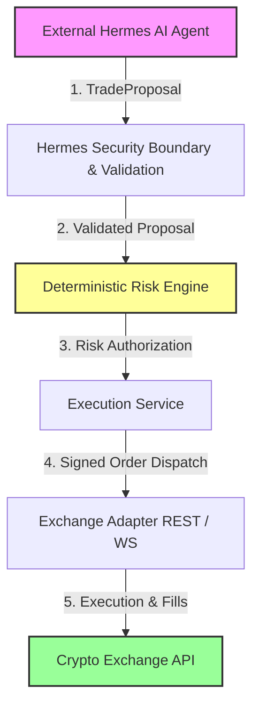

# Trader Control Center V2.1 (Hermes Autonomous Trading System)

[](https://www.python.org/)
[](https://fastapi.tiangolo.com/)
[](https://www.sqlite.org/)
[-brightgreen.svg)]()

A deterministic, AI-assisted automated cryptocurrency futures trading system built on the core principle:
> **"Probabilistic intelligence, deterministic authority."**

---

## Architecture Overview



### Core Components
- **Hermes AI Runtime Integration (`integration/hermes/`)**: External AI agent running on Ubuntu host. Generates market analysis, regime classification, and structured trade proposals. **NO direct exchange credentials or order authority.**
- **Deterministic Risk Engine (`core/risk/`)**: Non-bypassable financial safety boundary enforcing 20 risk validators (`V01`–`V20`) covering position caps, drawdown limits, exposure caps, leverage, spread, and kill switch status.
- **Execution Engine (`core/execution/`)**: Manages order state machine transitions, dual-layer idempotency (`proposal_id` & `client_order_id`), and fill processing.
- **REST Reconciliation Engine (`core/execution/reconciliation.py`)**: Authoritative reconciliation layer comparing local SQLite database records against remote exchange REST API state.
- **Trader Control Center Web UI (`web/`)**: Single-page FastAPI dashboard (port `8000`) for real-time portfolio monitoring, position visualization, AI decision audit logs, and emergency kill switch controls.

---

## Quick Start & Installation

### 1. Prerequisites
- Ubuntu 22.04 / 24.04 LTS x86_64
- Python 3.11+ (Python 3.13 recommended)
- Git, SQLite3, build-essential

### 2. Setup Virtual Environment
```bash
git clone https://github.com/AdhifCode/Autonomus-Trading-System-by-Hermes-Agent.git trading-system
cd trading-system
python3 -m venv .venv
source .venv/bin/activate
pip install --upgrade pip
pip install -e ".[dev,analytics]"
```

### 3. Initialize Database Migrations
```bash
python -m migrations.runner
```

### 4. Run System Verification & Test Suite
```bash
# Authoritative local system verification (46 gates)
python scripts/verify_system.py

# Full test suite (587 tests)
pytest tests/ -v
```
*Expected Output*: `587 passed in ~14s`

### 5. Launch Control Center Web Application
```bash
python -m uvicorn web.app:app --host 0.0.0.0 --port 8000
```
Open browser at `http://localhost:8000`

---

## Operational Commands & Trading Modes

| Trading Mode | Script / Entry Command | Target Purpose |
|---|---|---|
| **System Verification** | `python scripts/verify_system.py` | Local verification of all 46 subsystem gates |
| **Development** | `export TRADING_MODE=DEVELOPMENT && python -m uvicorn web.app:app --port 8000` | Local development & unit testing |
| **Paper Trading** | `python scripts/run_paper_session.py` | Simulated execution with 200ms latency |
| **Testnet Validation**| `python scripts/run_testnet_validation.py` | 15-module Binance Futures Testnet audit |
| **Production Audit**| `python scripts/run_production_readiness_audit.py` | Production readiness audit (0 Critical / 0 High) |
| **Limited Live Prep**| `python scripts/run_limited_live_prep.py` | Verification for limited live capital ($1,000 USD cap) |

---

## Safety & Security Boundaries

- **Zero Risk Engine Bypass**: No code path exists to bypass `RiskEngine.evaluate()`.
- **Hermes AI Hard Prohibitions**: Hermes AI is hard-blocked from submitting orders directly, reading exchange secrets, modifying risk policy, disabling the kill switch, or activating LIVE mode.
- **REST Authority Rule**: In financial state conflicts (`UNKNOWN`), exchange REST API data is authoritative.
- **Human Authorization Sign-Off**: LIVE mode activation requires explicit human sign-off via environment variable (`LIMITED_LIVE_HUMAN_AUTHORIZATION`).

---

## Documentation Index

- [`PRE_HERMES_AUDIT.md`](PRE_HERMES_AUDIT.md): Complete component inventory and cross-system dependency mapping.
- [`PRE_HERMES_ACCEPTANCE_REPORT.md`](PRE_HERMES_ACCEPTANCE_REPORT.md): Authoritative Pre-Hermes acceptance gate report.
- [`DEVELOPMENT_PLAN.md`](DEVELOPMENT_PLAN.md): Canonical 17-phase development roadmap and test mappings.
- [`DEVELOPMENT_PLAN_REALITY.md`](DEVELOPMENT_PLAN_REALITY.md): Reconciliation audit of all 17 engineering phases.
- [`OPERATIONS_GUIDE.md`](OPERATIONS_GUIDE.md): Master operational manual & emergency runbooks.
- [`SYSTEM_TRACEABILITY.md`](SYSTEM_TRACEABILITY.md): Component traceability matrix across architecture, code, and tests.
- [`SYSTEM_ACCEPTANCE_REPORT.md`](SYSTEM_ACCEPTANCE_REPORT.md): System acceptance verification report.
